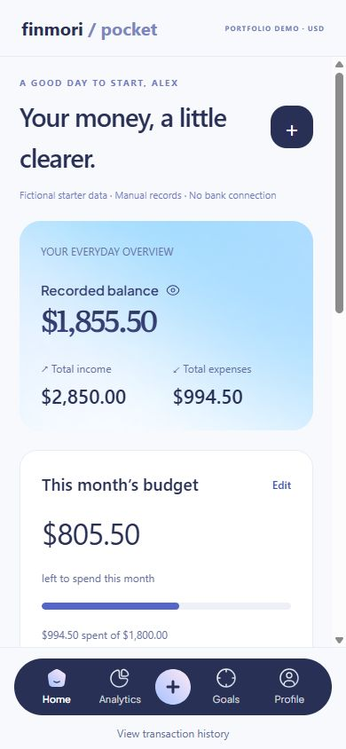

# Finmori Pocket

A personal finance portfolio app built with React Native, Expo and TypeScript, adapted from the MIT-licensed Finmori UI kit.

## Features

- Income and expense records with amount/date validation
- Searchable and filterable transaction history
- Calculated balance, monthly budget and category analytics
- Savings goals and contribution records
- Profile preferences and browser-local persistence
- Responsive mobile and desktop layouts



## Run

```sh
npm ci --ignore-scripts
npm run web
```

Open `/pocket`. For an exported build:

```sh
npm run build:web
npm run preview:pocket
```

Type check: `npm run typecheck:app`.

Original kit artwork is restored by the run/build scripts from a pinned upstream revision. The asset manifest verifies SHA-256 checksums. First run requires internet access; subsequent runs reuse verified files. The original asset license and attribution are retained.

## Scope

This is a portfolio demo with fictional starter data. It has no bank connection, money transfers, account authentication or cloud sync. Browser records persist in localStorage. Native previews currently use session-only storage and have not been device-tested.

## Credits and license

Original UI kit: [KhoaSuperman/Finmori-ReactNativeWeb](https://github.com/KhoaSuperman/Finmori-ReactNativeWeb).
Original design: Zoey Do / Finmori.
App adaptation and connected workflows: SMHRaja.

Retains the upstream MIT license and copyright notice. See [LICENSE](LICENSE) and [original documentation](README.upstream.md). This project is not affiliated with Daily UI.

See [verification](VERIFICATION.md) and [portfolio notes](PORTFOLIO.md).
